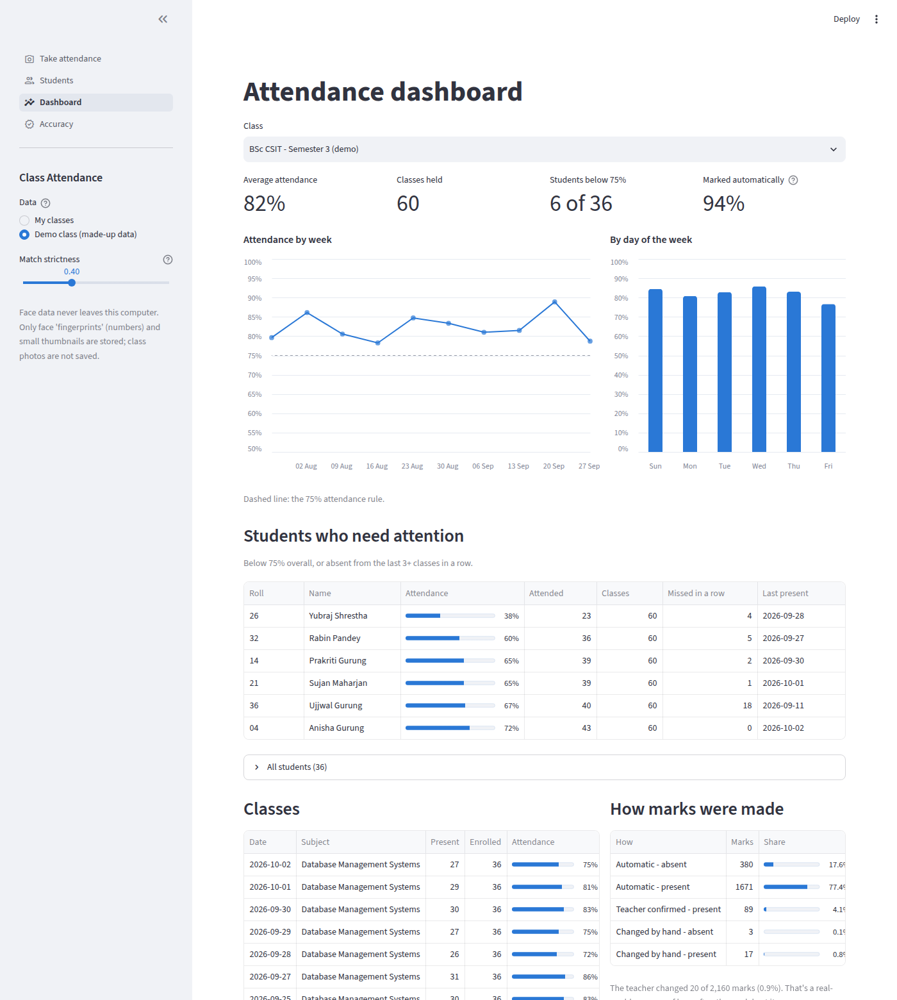
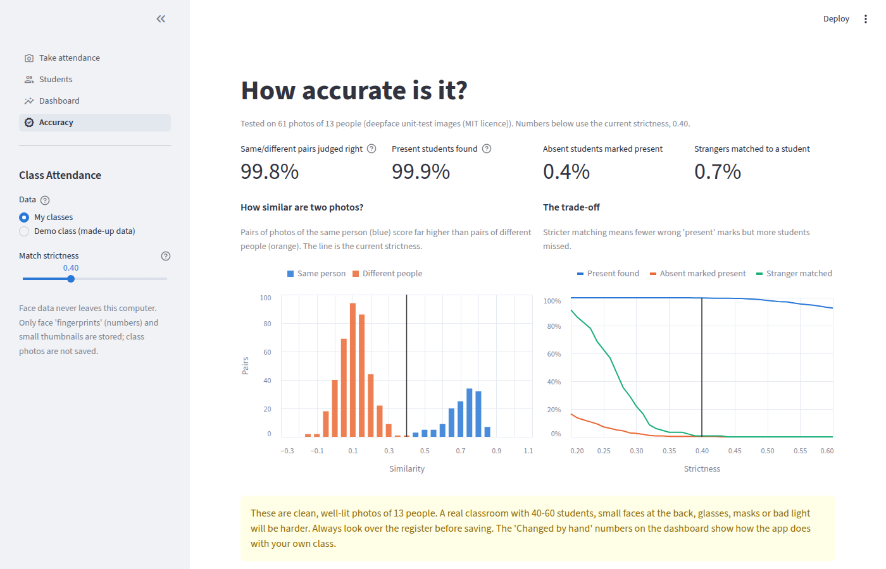

# Class Attendance from a Photo

Take one photo of the class. The app finds every face, recognises the enrolled students, and fills in the register. The teacher checks it and saves, and a dashboard tracks attendance over the semester.



## What it does

| Page | What happens |
|---|---|
| **Students** | Enroll each student once with 1–3 face photos (upload or webcam), or bulk-enroll a folder of files named like `01_Sita Sharma.jpg`. The app warns if a new face matches someone already enrolled. |
| **Take attendance** | Upload one or more class photos. Recognised students get green boxes. Faces the model isn't sure about are shown for the teacher to confirm. The register can be edited before saving. |
| **Dashboard** | Average attendance, weekly trend, day-of-week pattern, and students below the 75% rule or absent several classes in a row. It also shows how often the teacher had to correct the model. Exports a CSV or Excel register. |
| **Accuracy** | The measured accuracy of the face matching, and how the strictness setting trades missed students against wrong matches. |

## How it works

1. **Detect.** OpenCV's **YuNet** model finds faces and five landmarks (eyes, nose, mouth corners). It runs twice, at full size for small faces at the back of the room and at 640 px for large close-ups, and merges the results.
2. **Describe.** Each face is aligned using the landmarks, and **SFace** turns it into 128 numbers (an *embedding*). Photos of the same person give embeddings that point in nearly the same direction.
3. **Match.** Cosine similarity is computed between every face in the photo and every enrolled student. Pairs are assigned one-to-one, best first, so one student can't be matched to two faces.
4. **Let the teacher decide the unclear cases.** Faces scoring between 0.30 and the threshold (0.40) are never marked automatically. The model's guess is shown, but the default is "not a student", because a wrong *present* (proxy attendance) is worse than a miss that the teacher can see and fix.

Both models come from the [OpenCV Model Zoo](https://github.com/opencv/opencv_zoo) (Apache 2.0). They download automatically on first run (about 38 MB) and install on Windows, Mac or Linux with plain `pip`, with no C++ compiler, GPU or dlib needed.

## Accuracy



`evaluate.py` tests the matching on the public test images of the [deepface](https://github.com/serengil/deepface) library: 61 photos of 13 people with 528 labelled same/different pairs.

| Test | Result at strictness 0.40 |
|---|---|
| Same/different pairs judged correctly | 99.8% (ROC AUC 1.000) |
| Present students found (150 simulated class photos) | 99.9% |
| Absent students wrongly marked present | 0.4% |
| Strangers wrongly matched to a student | 0.7% |

**Choosing the threshold.** OpenCV publishes 0.363 for SFace. The sweep showed that 0.40 keeps essentially every true match while cutting wrong matches of strangers from 3.3% to 0.7%. Since wrong *present* marks are the costly error, the stricter value is the default. The sidebar slider changes it.

**Limits, stated honestly.** These are clean, well-lit photos of 13 adults, and the simulated class photos are collages of them. A real classroom of 40–60 students, with small faces at the back, turned heads, glasses, masks or poor light, will do worse. That's why the teacher reviews every register, and why the dashboard reports the share of marks changed by hand as a real-world accuracy measure.

## Run it

**Windows:** double-click `run_windows.bat`.
**Mac / Linux:** run `./run_mac_linux.sh`.

The first run creates a virtual environment and installs everything, which takes a few minutes. After that, the app opens in your browser at `http://localhost:8501`.

To run it manually instead:

```bash
python -m venv .venv
# Windows: .venv\Scripts\activate      Mac/Linux: source .venv/bin/activate
pip install -r requirements.txt
streamlit run app.py
```

To explore without real students, choose **Demo class (made-up data)** in the sidebar. It has 36 invented students and 10 weeks of attendance, with no faces.

Other commands:

```bash
python evaluate.py      # re-run the accuracy test (downloads the deepface test images to eval_data/)
python seed_demo.py     # rebuild the demo database
python -m pytest -q     # unit tests (pip install pytest)
```

Requires Python 3.10 or newer.

## Tips for good results

- **Enrollment:** front-facing, well-lit photos. Two or three photos per student (e.g. with and without glasses) help.
- **Class photo:** take it from the front with everyone facing the camera. Faces should be at least about 40 pixels tall. For a large room, upload 2–3 photos from different spots. A student matched in any photo counts as present.

## Privacy

Face recognition of students is sensitive personal data. Before using this with a real class:

- Get consent from students (and parents, for minors) and permission from the school.
- Everything stays on the computer running the app. Nothing is uploaded anywhere.
- Only the 128-number face embeddings and a small face thumbnail are stored. Enrollment and class photos are **not** saved.
- Deleting a student removes their face data and attendance records.
- `data/attendance.db` is in `.gitignore`, so real student data never ends up on GitHub.

## Project structure

```
app.py                  Streamlit app (4 pages)
attendance/
  engine.py             face detection, embeddings, matching, drawing
  db.py                 SQLite schema and storage
  analytics.py          dashboard metrics, written as SQL
evaluate.py             accuracy test and threshold sweep -> reports/accuracy.json
seed_demo.py            builds the made-up demo class
tests/                  unit tests (no photos or models needed)
```

### The data model

```
students(id, roll_no, name, class_name)
face_refs(student_id, embedding, thumbnail)          -- several per student
sessions(id, class_name, session_date, subject, faces_detected, unknown_faces)
attendance(session_id, student_id, status, method, similarity)
           status: present | absent      method: auto | confirmed | manual
```

Recording *how* each mark was made (`method`) is what lets the dashboard measure the model's real accuracy over time.

## Ideas to extend it

- Run detection on a live classroom camera at the start of each period
- Email or SMS alerts when a student drops below 75%
- Compare SFace with a larger model (e.g. ArcFace) on real class photos
- Track per-student recognition confidence, to spot who needs a better enrollment photo
